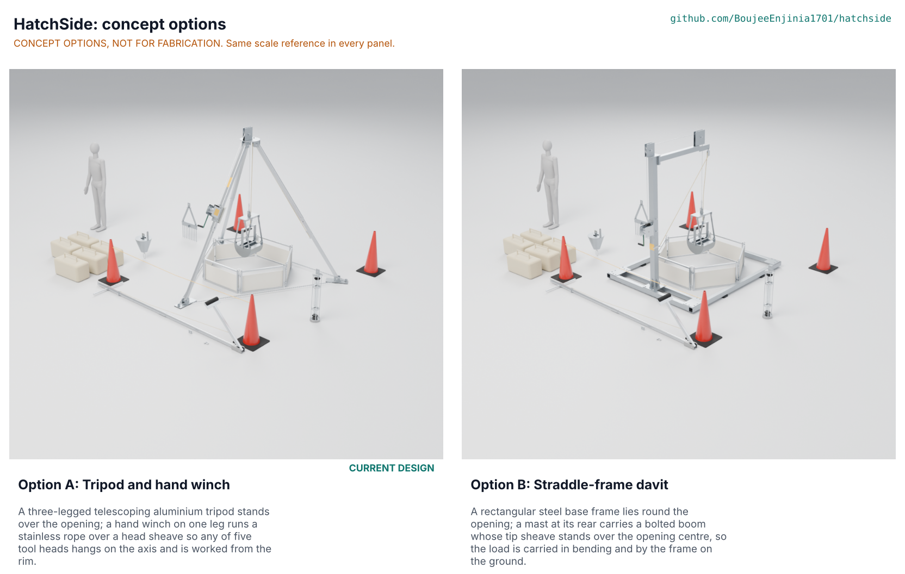

# HatchSide concept options

Result: option A, the tripod and hand winch (the current design), scores 160 of 180 against 138 for option B, the straddle-frame davit, a lead of 14 % that is outside the 10 % band, so the recommendation is option A, **Proposed, awaiting Amish** (HTS-DDR-003). Both options are modelled to detail level D3 in `cad/src/model.py`. Method: STANDARDS section 21.

## The options

### Option A: tripod and hand winch

Three telescoping aluminium legs pin to a steel head 2.25 m above the ground and stand on a 3.0 m circle over the opening; compression in the legs carries the load. A hand winch on one leg pays rope over a sheave in the head, and every tool head hangs from a screw-pin shackle on a standard interface. It is the design since kit 1.7 and does not change here. First-order numbers: leg buckling factor 5.5 and rope factor 14.3 at the design case, tips at 25.0 degrees, heaviest packed load 23.7 kg, USD 2,838 in parts (HTS-CAL-001). Risks: soft ground under the feet (RSK H4), misuse as a rescue tripod (H1), corrosion of aluminium against steel (STM S16). Needs from a partner: opening sizes, ground types, what the crew will actually carry.

### Option B: straddle-frame davit

A rectangular base frame of four 80 x 80 x 5 rails lies on the ground and straddles the opening; a bolted 100 x 100 x 5 mast rises behind it and carries an 80 x 80 x 4 boom that cantilevers over the opening with a sheave at its tip. The load is carried in bending, not compression, so the structure is heavy but very stable, and the winch sits on the mast at waist height. First-order numbers (HTS-CAL-001 section 11): mast 57 MPa, boom 95 MPa against 248 MPa allowable, tip angle 46 degrees, 348 kg with the heads, about USD 3,910 (estimate). Risks: the base frame must stand level on a street, its side rails weigh 26.2 kg against the 25 kg limit, and it takes longer to set up. Needs from a partner: whether crews have room for a 1.8 by 2.3 m frame at the opening.

## First-order numbers

Table 1. Options compared (option A figures from HTS-CAL-001, both options from the D3 models in `cad/fidelity.json`).

| Quantity | Option A | Option B |
| --- | --- | --- |
| Estimated parts cost (USD) | 2,838 (priced BOM) | About 3,910 (estimate from the steel mass; no BOM) |
| Mass of the modelled kit (kg) | 198 (kit 153, plus cones, chain and empty bags) | 348 (frame, mast, boom, winch and the five heads) |
| Setup time | 9.0 min (estimate) | Not estimated; about 25 bolts to tighten (estimate) |
| Effort at the crank (150 kg, low gear) | 31 N | 33 N |
| Tip angle at the safe working load | 25.0 degrees | 46 degrees |
| Heaviest single piece (kg) | 23.7 (grab head) | 26.2 (side rail) |
| Parts count (D3 model, `cad/fidelity.json`) | 395, of which 127 fasteners and 64 welds | 480, of which 233 fasteners and 67 welds |
| STEM check | 12 within, 6 plausible, none fails | 5 within, none fails |

## Scoring

Table 2. Weighted scoring (weights: High UR 3, Medium 2, Low 1; scores 1 to 5).

| Criterion | Source | Weight | A | B | Reason |
| --- | --- | --- | --- | --- | --- |
| No entry for routine jobs | UR-001 | 3 | 5 | 5 | Both carry the same five heads and are worked from the rim |
| Fits the openings we meet | UR-002 | 3 | 4 | 3 | A straddles on a 3.0 m circle; B needs a clear level area of 1.8 x 2.3 m beside the opening |
| Works at our depths | UR-003 | 3 | 5 | 5 | Same 15 m of rope and heads |
| Does the five jobs | UR-004 | 3 | 4 | 4 | Same heads; the grab nets 9.7 L against 10 L (PR-008 at risk) |
| Up in minutes | UR-005 | 2 | 5 | 2 | A 9.0 min estimate; B has a frame, a two-piece mast and a bolted boom, about 25 bolts to tighten |
| Carried by the crew | UR-006 | 3 | 4 | 2 | A heaviest load 23.7 kg; B side rails 26.2 kg and a longer pack list |
| Affordable | UR-007 | 3 | 5 | 3 | A USD 2,838 (BOM); B about USD 3,910 (estimate) |
| Never a lifeline, never tips | UR-008 | 3 | 4 | 5 | A tips at 25.0 degrees; B at 46 degrees; both carry the same labels |
| Lasts in sewage and sun | UR-009 | 2 | 4 | 4 | Same materials; B has more steel surface, A more aluminium to isolate |
| Changes heads fast | UR-010 | 2 | 5 | 5 | Same screw-pin interface |
| Made and mended locally | UR-011 | 2 | 4 | 4 | Both are cut, drilled and welded stock; A has more laser-cut plate, B more bolted joints |
| Guards the opening | UR-012 | 2 | 4 | 4 | Both carry the six-panel rim guard |
| Easy for one person to work | UR-013 | 2 | 4 | 4 | 31 N and 33 N crank force; B's winch is at waist height |
| Samples tell us where | UR-014 | 1 | 5 | 5 | Same line counter and sampler |
| Cost against the value-engineering target |  | 2 | 5 | 3 | USD 5,000 target; A is 43 % under it, B an estimated 22 % under |
| **Weighted total** | | | **160** | **138** | Maximum 180 |

Weighted total = sum of score x weight over the 15 criteria (maximum 180). Scores are the author's judgement from the first-order numbers; no user has scored them.

## Recommendation

Option A, **Proposed, awaiting Amish**. It leads by 22 points (14 % of its score), outside the 10 % band, so only A is proposed; Amish may still choose B or ask for another option. A wins on cost, setup time, portability and fit to small openings; B wins on stability and has the more comfortable winch height. Neither option has a Fails row in HTS-STM-001.

**The runner-up's best idea.** Option B puts the winch at waist height on a fixed mast (1.1 m above the ground), which is a more comfortable cranking posture than a winch bracket on a leg. Option A could offer a second bracket position lower on leg A; this is a value-engineering suggestion, **Proposed, awaiting Amish** (HTS-DEC-001), and is not applied to the model.

**Why not a third option.** A hand-cranked jib on a vehicle hitch or a wall bracket would be a third working principle, but it would need a vehicle or a wall at every opening, which the users in HTS-PRB-001 do not have; it is noted here and not modelled.

The concept selection record is HTS-DDR-003. The options picture `media/options.png` is rendered from the two D3 models by the coordinator and is not part of this commit.
